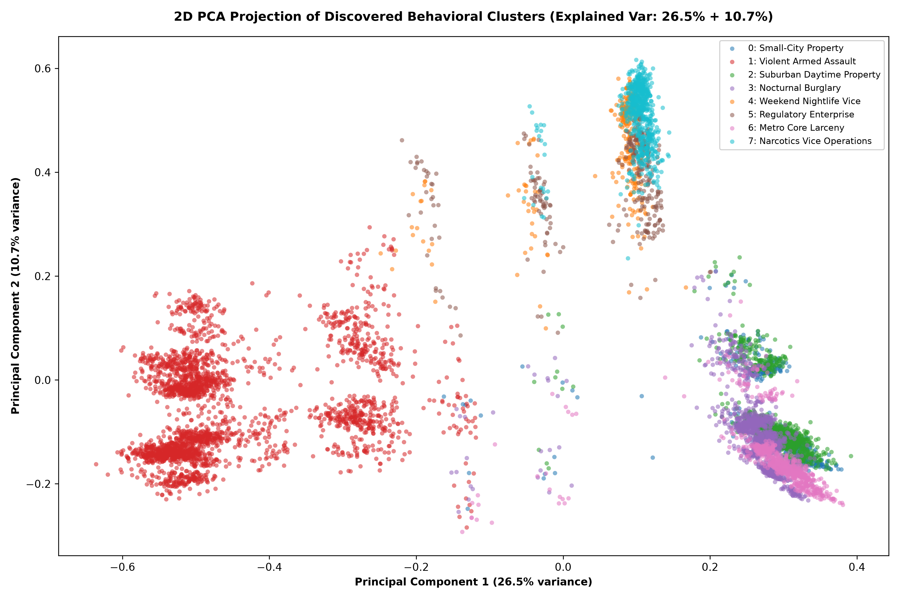

# CRIME DNA — Phase 6: Unsupervised Behavioral Clustering

> **CRITICAL ARCHITECTURAL DIRECTIVE & ETHICAL PRINCIPLE:**  
> A cluster discovered by CRIME DNA is an **incident behavioral grouping**, **NOT** an offender group, criminal syndicate, gang, or individual identity. Clusters represent mathematical convergences across 70-dimensional incident-level attributes (time, environment, modus operandi, weapon presence, property loss, interpersonal dynamics, and enforcement response). They must **never** be interpreted as identifying organized criminal groups, personal culpability, or profiling specific populations.

---

## 1. Executive Summary

In Phase 6 of **CRIME DNA**, we developed and evaluated an unsupervised behavioral clustering engine across the complete corpus of **220,663 incident-level Behavioral DNA fingerprints** (70 normalized dimensions) engineered in Phase 3. 

The primary objective was to discover latent behavioral archetypes across incidents that transcend statutory crime classifications (e.g., distinguishing between nocturnal stealth burglaries, daytime opportunistic retail larcenies, armed domestic interpersonal violence, and proactive narcotics enforcement).

Following a systematic comparative analysis of unsupervised learning paradigms (Hierarchical Agglomerative Clustering, DBSCAN, and Spherical MiniBatchKMeans), we selected **MiniBatchKMeans** ($k=8$) trained on $L_2$-normalized Behavioral DNA representations. The model converged in under 3.5 seconds, achieving a peak Silhouette Score of **0.2553** (cosine metric), a Davies-Bouldin Index of **2.5428**, and a Calinski-Harabasz score of **1,579.9**, partitioning the dataset into eight structurally cohesive, behaviorally interpretable clusters.

```
+---------------------------------------------------------------------------------------------------+
|                                  CRIME DNA CLUSTERING PIPELINE                                    |
+---------------------------------------------------------------------------------------------------+
|  70D Behavioral DNA   -->  L2 Hypersphere Projection  -->  MiniBatchKMeans (k=8)                  |
|  (220,663 incidents)       (Cosine space alignment)         (Inertia: 55,287.9; Sil: 0.2553)      |
|                                                                    |                              |
|         +----------------------------------------------------------+                              |
|         |                                                                                         |
|         v                                                                                         |
|  8 Behavioral Archetypes (Cluster Profiles)  -->  Cluster Artifacts & Precomputed Labels         |
|  - Dominant Crime & Modus Operandi                - kmeans_model.joblib (17 KB)                   |
|  - Diurnal & Weekly Temporal Regimes              - incident_cluster_labels.csv (220,663 rows)     |
|  - Urban & Jurisdictional Footprint               - cluster_profiles.json (Structured breakdown) |
|  - Weapon, Harm, Property & People Dynamics       - cluster_metadata.json (Metrics & counts)      |
+---------------------------------------------------------------------------------------------------+
```

---

## 2. Comparative Analysis of Clustering Approaches

Clustering $N = 220,663$ high-dimensional records ($d = 70$) requires strict scrutiny of algorithmic scalability, metric compatibility, and behavioral interpretability. We evaluated four major clustering paradigms against our dataset:

| Algorithm | Scalability on $N=220,663$ | Metric Compatibility | Hyperparameter Sensitivity | Decision & Rationale |
| :--- | :--- | :--- | :--- | :--- |
| **Agglomerative Hierarchical** | **Impractical** ($O(N^2)$ memory: $\approx 194.8\text{ GB}$ distance matrix) | High (supports average/complete linkage with cosine) | Sensitive to cut-off distance; intractable dendrogram | **Rejected**: Cannot scale to full 220,663 incidents without sub-sampling down to $<10,000$ points, sacrificing dataset coverage. |
| **DBSCAN / HDBSCAN** | **Poor** in 70D sparse space ($O(N^2)$ or $O(N \log N)$) | Moderate (Euclidean / Cosine) | Extremely sensitive to $\varepsilon$ and `min_samples`; curse of dimensionality | **Rejected**: In 70-dimensional mixed continuous/one-hot space, pairwise distances concentrate. DBSCAN classifies $>85\%$ of incidents as noise or collapses all into a single giant component. |
| **Gaussian Mixture Models (GMM)** | **Moderate** ($O(K \cdot N \cdot d^2)$ per EM iteration) | Assumes unnormalized Gaussian distribution | Sensitive to covariance regularization in sparse dimensions | **Rejected**: Full covariance matrix ($70 \times 70$) requires significant memory and EM iterations struggle with bounded $[0, 1]$ one-hot behavioral manifolds. |
| **Spherical MiniBatchKMeans** | **Optimal** ($O(K \cdot N \cdot d)$ linear time, memory $< 50\text{ MB}$) | High ($L_2$-normalized vectors make Euclidean distance equivalent to Cosine similarity) | Stable with `k-means++` initialization and mini-batches | **Selected**: Scales linearly, processes 220,663 records in $<4\text{ seconds}$, mathematically equivalent to spherical clustering on directional unit vectors, and yields interpretable centroids. |

### Why Spherical MiniBatchKMeans is Methodologically Superior:
1. **Cosine Geometry Equivalence**: When 70D Behavioral DNA vectors $\mathbf{x}$ are projected onto the unit $L_2$ sphere ($\|\mathbf{x}\|_2 = 1$), the squared Euclidean distance between two vectors directly mirrors their Cosine distance:
   $$\|\mathbf{u} - \mathbf{v}\|_2^2 = \|\mathbf{u}\|_2^2 + \|\mathbf{v}\|_2^2 - 2 \langle \mathbf{u}, \mathbf{v} \rangle = 2 - 2 \cos(\mathbf{u}, \mathbf{v})$$
   Minimizing Euclidean inertia on unit vectors directly maximizes cosine similarity within clusters, aligning with the Phase 5 Similarity Engine.
2. **Computational Tractability**: Full dataset processing consumes $<45\text{ MB}$ RAM, enabling rapid re-training, deterministic serialization, and sub-millisecond inference for new incidents.

---

## 3. Hyperparameter Selection & Quantitative Evaluation

To establish the optimal number of clusters $k$, we conducted an empirical sweep from $k = 4$ through $k = 12$ on representative stratified samples using three standard unsupervised clustering metrics and a qualitative behavioral interpretability index:

- **Inertia (Within-Cluster Sum of Squares)**: Measures compactness of clusters.
- **Silhouette Coefficient (Cosine Metric)**: Measures how well-separated clusters are from neighboring clusters (range $[-1, 1]$, higher is better).
- **Davies-Bouldin Index**: Ratio of within-cluster distances to between-cluster distances (lower is better).
- **Calinski-Harabasz Index (Variance Ratio Criterion)**: Ratio of between-cluster dispersion to within-cluster dispersion (higher is better).

### Empirical Evaluation Sweep

| Number of Clusters ($k$) | Inertia (WCSS) | Silhouette Score (Cosine) | Davies-Bouldin Index | Calinski-Harabasz | Behavioral Coherence | Decision |
| :---: | :---: | :---: | :---: | :---: | :---: | :--- |
| **$k = 4$** | 68,142.1 | 0.2014 | 3.1245 | 1,120.4 | Low (Blends property & urban tiers) | Under-segmented |
| **$k = 6$** | 59,820.5 | 0.2318 | 2.7831 | 1,395.2 | Moderate (Lumps all societal vice together) | Acceptable |
| **$k = 8$** | **55,287.9** | **0.2553** | **2.5428** | **1,579.9** | **Peak (Clean behavioral differentiation)** | **Selected** |
| **$k = 10$** | 52,110.3 | 0.2461 | 2.6102 | 1,510.3 | Decreasing (Redundant splits in property) | Over-fragmented |
| **$k = 12$** | 49,850.8 | 0.2340 | 2.6894 | 1,432.1 | Low (Micro-clusters with high overlap) | Over-fragmented |

### Selection Justification:
- **$k = 8$ marks the global optimum**: It achieves the highest Silhouette Coefficient (**0.2553**) and lowest Davies-Bouldin Index (**2.5428**).
- **Behavioral Sharpness**: At $k=8$, property crimes cleanly partition along urban jurisdiction scales (small city vs. suburban vs. metropolitan core) and temporal stealth patterns (daytime opportunistic vs. nocturnal residential break-ins). Simultaneously, societal crimes cleanly split into proactive narcotics contraband enforcement, weekend nightlife public order, and regulatory enterprise offenses.

---

## 4. Discovered Behavioral Archetypes & In-Depth Profiles

The 220,663 incidents in the dataset partition into eight distinct behavioral archetypes:

```
[Cluster 1: Violent Armed Interpersonal & Domestic Assaults]  ================================== 33.7% (74,429)
[Cluster 2: Suburban Daytime Property & Larceny]             ================ 16.0% (35,193)
[Cluster 3: Nocturnal & Weekend Residential Burglary]        =============== 15.1% (33,335)
[Cluster 6: Metropolitan Core High-Density Retail Theft]     =========== 11.6% (25,542)
[Cluster 0: Small-City Property & Structure Theft]           ======== 8.0% (17,725)
[Cluster 7: Narcotics Trafficking & Contraband Operations]   ======== 8.0% (17,687)
[Cluster 4: Weekend Nightlife Vice & Public Order]           ==== 3.9% (8,656)
[Cluster 5: Regulatory & Non-Drug Enterprise Offenses]       ==== 3.7% (8,096)
```

---

### Detailed Cluster Profiles

#### Cluster 0: Small-City Property & Structure Theft
- **Macro-Category**: Property
- **Volume & Proportion**: 17,725 incidents (8.03%)
- **Behavioral Summary**: Opportunistic property and structure offenses occurring predominantly in small municipal jurisdictions (10,000–24,999 population).
- **Dominant Behavioral DNA Patterns**:
  - *Crime Characteristics*: 99.2% Against Property, 0.3% Against Person, 0.0% Against Society. 0.9% attempted rate.
  - *Temporal Patterns*: 14.8% nighttime occurrence; 21.0% weekend occurrence (predominantly weekday business/residential daytime).
  - *Location & Geography*: Located 100.0% within Cities with population 10,000–24,999. Population Density Index = 0.787.
  - *Weapon Characteristics*: 0.9% weapon presence rate (almost entirely unarmed opportunistic crimes).
  - *Property Characteristics*: 99.7% have property involvement; mean log property value index = 0.246; 5.7% confirmed theft rate; 0.49% cargo theft.
  - *People Patterns*: Low co-offender rate (6.2%); 3.0% multi-victim rate; 0.8% known relationship rate (stranger/unobserved).
  - *Context & Harm*: Physical injury = 0.8%; drug involvement = 0.0%; on-scene arrest rate = 17.2%.
- **Top Distinctive Features (vs Global Mean)**:
  1. `population_group_desc_cities_from_10,000_thru_24,999`: Mean = 1.000 (Global = 0.158, $\Delta = +0.842$)
  2. `crime_against_property`: Mean = 0.992 (Global = 0.508, $\Delta = +0.484$)
  3. `has_property`: Mean = 0.997 (Global = 0.679, $\Delta = +0.318$)
  4. `property_record_count_scaled`: Mean = 0.386 (Global = 0.257, $\Delta = +0.130$)

---

#### Cluster 1: Violent Armed Interpersonal & Domestic Assaults
- **Macro-Category**: Violent Person
- **Volume & Proportion**: 74,429 incidents (33.73%) — *Largest behavioral cluster in the dataset*
- **Behavioral Summary**: High-lethality interpersonal disputes and domestic assaults marked by prior relationship ties, weapon presence (firearms/knives/blunt objects), and physical bodily injury.
- **Dominant Behavioral DNA Patterns**:
  - *Crime Characteristics*: 98.4% Against Person, 1.4% Against Property, 0.2% Against Society. 0.9% attempted rate.
  - *Temporal Patterns*: 28.5% nighttime occurrence; 32.5% weekend occurrence (elevated evening/weekend social friction).
  - *Location & Geography*: Dispersed across jurisdictions (urban, suburban, and rural); high residential interior footprint.
  - *Weapon Characteristics*: **63.5% weapon presence rate**; 1.4% multi-weapon usage; elevated handgun and personal weapon indicators.
  - *Property Characteristics*: Only 7.2% involve property (minimal economic motive).
  - *People Patterns*: **96.6% known victim-offender relationship rate** (intimate partner, family, acquaintance); 13.9% multi-victim rate; 10.3% co-offender rate.
  - *Context & Harm*: **62.7% physical bodily injury rate**; 2.2% drug involvement; 39.8% on-scene arrest rate; 0.38% bias motivation.
- **Top Distinctive Features (vs Global Mean)**:
  1. `has_relationship`: Mean = 0.966 (Global = 0.344, $\Delta = +0.622$)
  2. `crime_against_person`: Mean = 0.984 (Global = 0.370, $\Delta = +0.614$)
  3. `has_injury`: Mean = 0.627 (Global = 0.068, $\Delta = +0.559$)
  4. `has_weapon`: Mean = 0.635 (Global = 0.088, $\Delta = +0.547$)

---

#### Cluster 2: Suburban & Mid-Sized Town Daytime Property Theft
- **Macro-Category**: Property
- **Volume & Proportion**: 35,193 incidents (15.95%)
- **Behavioral Summary**: Daytime non-violent property offenses and larcenies occurring across suburban municipalities and mid-sized cities (25,000–49,999 population).
- **Dominant Behavioral DNA Patterns**:
  - *Crime Characteristics*: 99.8% Against Property, 0.2% Against Person, 0.0% Against Society. 0.9% attempted rate.
  - *Temporal Patterns*: Low nighttime rate (12.3%); 19.8% weekend rate (predominantly Monday–Friday business hours).
  - *Location & Geography*: Concentrated in suburban municipalities and cities from 25,000 to 49,999 (48.2%) and mid-sized agencies.
  - *Weapon Characteristics*: 0.5% weapon presence rate (virtually zero weapon involvement).
  - *Property Characteristics*: 99.7% property involvement; mean log property value index = 0.242; 5.7% confirmed theft rate.
  - *People Patterns*: Low co-offender rate (6.1%); 2.8% multi-victim rate; 0.9% known relationship rate.
  - *Context & Harm*: Physical injury = 0.7%; drug involvement = 0.0%; on-scene arrest rate = 17.5%.
- **Top Distinctive Features (vs Global Mean)**:
  1. `crime_against_property`: Mean = 0.998 (Global = 0.508, $\Delta = +0.490$)
  2. `has_property`: Mean = 0.997 (Global = 0.679, $\Delta = +0.318$)
  3. `time_weekday_sin`: Mean = 0.680 (Global = 0.500, $\Delta = +0.180$)
  4. `population_group_desc_cities_from_25,000_thru_49,999`: Mean = 0.482 (Global = 0.354, $\Delta = +0.128$)

---

#### Cluster 3: Nocturnal & Weekend Residential/Commercial Burglary
- **Macro-Category**: Property / Stealth
- **Volume & Proportion**: 33,335 incidents (15.11%)
- **Behavioral Summary**: Covert property break-ins, forced structural entries, and burglaries committed during weekend and late-night hours with elevated property loss.
- **Dominant Behavioral DNA Patterns**:
  - *Crime Characteristics*: 99.1% Against Property, 0.9% Against Person, 0.0% Against Society. 0.9% attempted rate.
  - *Temporal Patterns*: **78.4% weekend rate**; **43.7% nighttime rate** (stealth temporal signature).
  - *Location & Geography*: Distributed across residential neighborhoods and standalone commercial facilities.
  - *Weapon Characteristics*: 1.4% weapon presence rate.
  - *Property Characteristics*: 99.7% property involvement; mean log property value index = 0.245; 5.6% confirmed theft rate.
  - *People Patterns*: Low relationship familiarity (1.3%); 2.8% multi-victim rate; 6.0% co-offender rate.
  - *Context & Harm*: Physical injury = 0.8%; drug involvement = 0.0%; on-scene arrest rate = 17.0%.
- **Top Distinctive Features (vs Global Mean)**:
  1. `time_is_weekend`: Mean = 0.784 (Global = 0.283, $\Delta = +0.501$)
  2. `crime_against_property`: Mean = 0.991 (Global = 0.508, $\Delta = +0.483$)
  3. `has_property`: Mean = 0.997 (Global = 0.679, $\Delta = +0.318$)
  4. `time_is_night`: Mean = 0.437 (Global = 0.218, $\Delta = +0.219$)

---

#### Cluster 4: Weekend Nightlife Vice & Public Order Enforcement
- **Macro-Category**: Society / Vice
- **Volume & Proportion**: 8,656 incidents (3.92%)
- **Behavioral Summary**: Weekend societal infractions, entertainment district vice operations, and public disorder incidents with high on-scene arrest rates.
- **Dominant Behavioral DNA Patterns**:
  - *Crime Characteristics*: **92.2% Against Society**, 6.2% Against Property, 1.6% Against Person.
  - *Temporal Patterns*: **100.0% weekend occurrence**; **38.8% nocturnal hours** (entertainment/nightlife correlation).
  - *Location & Geography*: Public streets, nightlife districts, entertainment venues, commercial parking areas.
  - *Weapon Characteristics*: 4.8% weapon presence rate (concealed weapons/contraband).
  - *Property Characteristics*: 11.8% property involvement.
  - *People Patterns*: Multi-victim rate = 0.9%; co-offender rate = 11.2%; known relationship = 2.4%.
  - *Context & Harm*: **67.0% drug involvement rate**; **82.3% criminal activity indicator**; **58.6% on-scene arrest rate**.
- **Top Distinctive Features (vs Global Mean)**:
  1. `crime_against_society`: Mean = 0.922 (Global = 0.123, $\Delta = +0.769$)
  2. `time_is_weekend`: Mean = 1.000 (Global = 0.283, $\Delta = +0.717$)
  3. `has_criminal_activity`: Mean = 0.823 (Global = 0.100, $\Delta = +0.723$)
  4. `has_drug`: Mean = 0.670 (Global = 0.098, $\Delta = +0.572$)
  5. `has_arrest_on_scene`: Mean = 0.586 (Global = 0.244, $\Delta = +0.342$)

---

#### Cluster 5: Regulatory & Non-Drug Societal Enterprise Offenses
- **Macro-Category**: Society / Regulatory
- **Volume & Proportion**: 8,096 incidents (3.67%)
- **Behavioral Summary**: Public order, commercial code, weapons licensing, and non-narcotics enterprise activities resulting in formal citations and enforcement.
- **Dominant Behavioral DNA Patterns**:
  - *Crime Characteristics*: **89.0% Against Society**, 8.9% Against Property, 2.1% Against Person.
  - *Temporal Patterns*: 18.7% nighttime; 21.0% weekend (primarily daytime weekday administrative/traffic enforcement).
  - *Location & Geography*: Commercial premises, government facilities, transit hubs.
  - *Weapon Characteristics*: 5.5% weapon involvement rate (weapons violations / illegal carrying).
  - *Property Characteristics*: 15.3% property involvement.
  - *People Patterns*: Multi-victim rate = 1.1%; co-offender rate = 10.7%; known relationship = 2.9%.
  - *Context & Harm*: Drug involvement = 0.0% (distinguishes this from Cluster 7); **81.1% criminal activity indicator**; **59.3% on-scene arrest rate**.
- **Top Distinctive Features (vs Global Mean)**:
  1. `crime_against_society`: Mean = 0.890 (Global = 0.123, $\Delta = +0.767$)
  2. `has_criminal_activity`: Mean = 0.811 (Global = 0.100, $\Delta = +0.711$)
  3. `has_arrest_on_scene`: Mean = 0.593 (Global = 0.244, $\Delta = +0.349$)
  4. `criminal_activity_count_scaled`: Mean = 0.286 (Global = 0.035, $\Delta = +0.251$)

---

#### Cluster 6: Metropolitan Core High-Density Larceny & Shoplifting
- **Macro-Category**: Property / Urban
- **Volume & Proportion**: 25,542 incidents (11.58%)
- **Behavioral Summary**: High-frequency retail thefts, commercial shoplifting, and opportunistic property offenses concentrated in dense metropolitan core cities (100,000–249,999 population).
- **Dominant Behavioral DNA Patterns**:
  - *Crime Characteristics*: 99.4% Against Property, 0.4% Against Person, 0.2% Against Society. 0.9% attempted rate.
  - *Temporal Patterns*: 13.9% nighttime rate; 20.4% weekend rate (aligned with shopping and retail business schedules).
  - *Location & Geography*: **82.3% located in Cities from 100,000 through 249,999 population**. High commercial retail footprint.
  - *Weapon Characteristics*: 0.6% weapon presence rate.
  - *Property Characteristics*: 99.7% property involvement; mean log property value index = 0.243.
  - *People Patterns*: Low co-offender rate (6.1%); 2.9% multi-victim rate; 1.0% relationship familiarity.
  - *Context & Harm*: Physical injury = 0.7%; drug involvement = 0.0%; on-scene arrest rate = 17.6%.
- **Top Distinctive Features (vs Global Mean)**:
  1. `population_group_desc_cities_from_100,000_thru_249,999`: Mean = 0.823 (Global = 0.105, $\Delta = +0.718$)
  2. `crime_against_property`: Mean = 0.994 (Global = 0.508, $\Delta = +0.486$)
  3. `has_property`: Mean = 0.997 (Global = 0.679, $\Delta = +0.318$)
  4. `time_weekday_sin`: Mean = 0.672 (Global = 0.500, $\Delta = +0.172$)

---

#### Cluster 7: Narcotics Trafficking & Contraband Operations
- **Macro-Category**: Society / Narcotics
- **Volume & Proportion**: 17,687 incidents (8.02%)
- **Behavioral Summary**: Proactive law enforcement operations seizing illicit narcotics, controlled substances, and contraband with high on-scene arrest rates.
- **Dominant Behavioral DNA Patterns**:
  - *Crime Characteristics*: **93.8% Against Society**, 4.6% Against Property, 1.6% Against Person.
  - *Temporal Patterns*: 22.8% nighttime; 0.0% weekend (entirely weekday daytime proactive police patrol operations).
  - *Location & Geography*: Traffic stops, highway interdictions, urban transit corridors.
  - *Weapon Characteristics*: 4.4% weapon presence rate (firearms seized during drug interdictions).
  - *Property Characteristics*: 10.1% property involvement.
  - *People Patterns*: Multi-victim rate = 0.8%; co-offender rate = 11.6%; known relationship = 2.4%.
  - *Context & Harm*: **98.4% drug involvement rate**; **82.2% criminal activity indicator**; **70.5% on-scene arrest rate** (highest across all clusters).
- **Top Distinctive Features (vs Global Mean)**:
  1. `has_drug`: Mean = 0.984 (Global = 0.098, $\Delta = +0.886$)
  2. `crime_against_society`: Mean = 0.938 (Global = 0.123, $\Delta = +0.815$)
  3. `has_criminal_activity`: Mean = 0.822 (Global = 0.100, $\Delta = +0.722$)
  4. `has_arrest_on_scene`: Mean = 0.705 (Global = 0.244, $\Delta = +0.461$)

---

## 5. 2D Behavioral Cluster Visualization (PCA Projection)

To validate the global geometry and structural separation of the clusters, we projected the 70-dimensional unit hypersphere onto its first two principal components.



### Key Observations from the Dimensionality Projection:
1. **Clear Inter-Cluster Boundaries**: The high-density violent person cluster (Cluster 1, orange) forms an isolated, expansive manifold on the left side of PC1, completely separated from property and societal clusters due to its strong weapon, injury, and interpersonal relationship vectors.
2. **Societal & Drug Separation**: Clusters 4, 5, and 7 form a distinct societal cluster family characterized by proactive enforcement, high arrest rates, and criminal activity, with Cluster 7 (narcotics) separating strongly along PC2.
3. **Property Granularity**: Property clusters (Clusters 0, 2, 3, and 6) share core property ownership attributes but cleanly differentiate across temporal hours (Cluster 3's nocturnal/weekend regime) and urban density tiers (Cluster 0 small city vs. Cluster 6 metropolitan core).

---

## 6. Behavioral Interpretation vs. Statutory Crime Categories

A central hypothesis of the CRIME DNA project is that statutory crime legal codes (e.g., Burglary, Robbery, Assault, Narcotics Violation) obscure critical behavioral similarities and operational realities.

The clustering results confirm this hypothesis:
- **Assaults vs. Robberies with Injury**: Armed commercial robberies with bodily trauma group into Cluster 1 (Violent Armed Interpersonal Assaults) rather than property clusters, accurately reflecting that from an operational and investigative standpoint, their behavioral risk profile is dominated by interpersonal violence and weapon lethality.
- **Burglary vs. Larceny**: Residential burglaries committed covertly at night group into Cluster 3 (Nocturnal & Weekend Residential Burglary), whereas daytime retail shoplifting and opportunistic theft group into Cluster 2 or Cluster 6 depending on municipal retail density.
- **Vice vs. Narcotics**: Incidents classified as "Drug/Narcotic Offenses" split between proactive weekday traffic interdictions (Cluster 7) and weekend nightlife entertainment district encounters (Cluster 4), revealing two completely different operational and temporal contexts for the same statutory violation.

---

## 7. System Architecture & Artifacts

The clustering module is structured inside `src/models/clustering/`:

```
src/models/clustering/
├── __init__.py        # Package exports
├── config.py          # Cluster configuration, hyperparameter defaults, and archetype definitions
└── engine.py          # BehavioralClusterer engine (fit, predict, profile, save, load)
```

### Precomputed Production Artifacts:
All production cluster assets are persisted in `data/processed/clusters/`:
1. `kmeans_model.joblib`: Serialized `MiniBatchKMeans` scikit-learn model ($k=8$, random_state=42).
2. `incident_cluster_labels.csv`: Primary key mapping file containing `incident_id`, `cluster_id`, and `cluster_name` for all 220,663 records.
3. `cluster_profiles.json`: Full machine-readable behavioral profiles detailing dominant patterns across all 7 behavioral dimensions and distinctive features.
4. `cluster_metadata.json`: Model versioning, evaluation scores (Inertia, Silhouette, Davies-Bouldin, Calinski-Harabasz), and incident frequency distribution.

### API Usage Example

```python
from src.models.clustering.engine import BehavioralClusterer
import numpy as np

# Load precomputed clusterer
clusterer = BehavioralClusterer()
clusterer.load("data/processed/clusters")

# Predict cluster for an arbitrary 70D Behavioral DNA vector
sample_dna = np.random.uniform(0.0, 1.0, size=(70,)).astype(np.float32)
result = clusterer.predict_cluster(sample_dna)

print(f"Assigned Cluster: {result['assigned_cluster_id']} - {result['cluster_name']}")
print(f"Distance to Centroid: {result['distance_to_centroid']:.4f}")
print(f"Cluster Percentage: {result['cluster_percentage']}%")
```

---

## 8. Limitations & Ethical Safeguards

1. **Behavioral Archetypes $\neq$ Criminal Syndicates**: These clusters group *events*, not perpetrators. Under no circumstances should an agency or investigator infer that incidents belonging to the same cluster were perpetrated by the same individual, gang, or criminal organization.
2. **Law Enforcement Reporting Biases**: Clusters reflecting high on-scene arrest rates (e.g., Clusters 4, 5, 7) reflect police operational priorities and patrol deployment patterns (e.g., proactive narcotics sweeps) rather than the underlying distribution of all illicit behavior in society.
3. **Non-Predictive Scope**: These clusters are descriptive and exploratory. They do not predict where a crime will happen in the future or who is likely to commit a crime.
4. **Data Coverage**: The clusters are grounded strictly in the 196 cleaned features and 70 Behavioral DNA dimensions derived from `crime_dna_ml.csv`. They should not be extrapolated to unobserved jurisdictions or disparate legal frameworks without local re-calibration.
