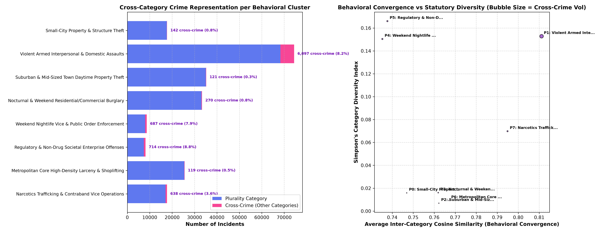

# CRIME DNA — Phase 7: Cross-Crime Behavioral Pattern Discovery

> **CRITICAL ARCHITECTURAL DIRECTIVE & ETHICAL SAFEGUARD:**  
> A Cross-Crime Pattern discovered by CRIME DNA is a **shared behavioral signature**, **NOT** an offender identity, crime ring, or serial perpetrator linkage. Incidents grouped within a cross-crime pattern share objective situational characteristics—such as temporal windows, environmental contexts, weapon presence, and victim-offender interpersonal dynamics—even though they were filed under legally distinct penal categories.  
> **Under no circumstances should the system or analyst assert that incidents sharing a cross-crime pattern were committed by the same individual or organization.**

---

## 1. Executive Summary

Statutory penal codes classify crimes based on legal definitions (e.g., Aggravated Assault, Robbery, Burglary, Larceny, Narcotics Violation, Disorderly Conduct). However, real-world criminal events frequently exhibit **behavioral convergence across statutory boundaries**. An armed domestic dispute and an armed robbery may share higher behavioral similarity (weapon brandishing, physical trauma, close interpersonal proximity) than an armed robbery shares with an unobserved midnight commercial burglary.

In Phase 7 of **CRIME DNA**, we engineered the **Cross-Crime Pattern Analyzer** (`src/models/cross_crime/`), leveraging the 70-dimensional Behavioral DNA representations from Phase 3 and the 8 unsupervised clusters discovered in Phase 6. Across the complete corpus of **220,663 incidents**, the analyzer uncovered **8,788 cross-crime incidents** spanning multiple statutory categories within shared behavioral basins.

```
+---------------------------------------------------------------------------------------------------------+
|                                    CROSS-CRIME BEHAVIORAL DISCOVERY                                     |
+---------------------------------------------------------------------------------------------------------+
|  70D Behavioral DNA       -->  8 Behavioral Basins (Clusters)  -->  Cross-Category Intersections        |
|  (220,663 incidents)           (Minimizing Intra-Cluster WCSS)       (8,788 cross-category incidents)   |
|                                                                                |                        |
|         +----------------------------------------------------------------------+                        |
|         v                                                                                               |
|  8 Distinct Cross-Crime Patterns (CCP_00 to CCP_07)                                                     |
|  - Quantitative Category Diversity (Simpson Index up to 0.166)                                          |
|  - Inter-Category Behavioral Convergence (Average Cosine Similarity: 0.735 to 0.811)                   |
|  - Concrete Exemplar Triads (Incident A [Cat 1] <-> Incident B [Cat 2] <-> Incident C [Cat 3])          |
|  - Machine-Readable JSON Outputs for Frontend (`data/processed/cross_crime/`)                           |
+---------------------------------------------------------------------------------------------------------+
```

---

## 2. Methodological Framework: Behavioral DNA vs. Statutory Codes

### Why Statutory Codes Obscure Operational Realities
Statutory classifications are optimized for prosecutorial and penal processing rather than behavioral pattern analysis:
1. **The Compound Crime Paradox**: Many crimes simultaneously involve multiple legal codes (e.g., an incident where an intruder forces entry, assaults an occupant, and steals jewelry). In administrative reporting, this may be tagged as "Burglary", "Assault", or a compound category, fracturing unified behavioral series.
2. **Behavioral Equivalence Across Legal Labels**: A street robbery with a weapon and an aggravated interpersonal assault share identical lethality, weapon brandishing, and physical trauma signatures, yet are split into disparate Uniform Crime Reporting (UCR) buckets.
3. **Contextual Invariance**: Proactive narcotics traffic stops and contraband weapon seizures share identical temporal hours, vehicle settings, and on-scene arrest dynamics regardless of whether the seized substance was marijuana, an illegal handgun, or stolen merchandise.

### Mathematical Formulation of Cross-Crime Convergence
For each behavioral cluster $\mathcal{C}_k$ ($k \in \{0, \dots, 7\}$):
1. **Category Representation**: We measure the distribution of statutory crime categories $\{c_1, c_2, \dots, c_m\} \in \mathcal{C}_k$.
2. **Simpson's Category Diversity Index**:
   $$D = 1 - \sum_{i=1}^m p_i^2$$
   where $p_i$ is the proportion of incidents in $\mathcal{C}_k$ belonging to category $c_i$. High $D$ indicates substantial cross-crime mixing.
3. **Inter-Category Centroid Cosine Similarity**:
   For any two distinct crime categories $c_a$ and $c_b$ within cluster $\mathcal{C}_k$, we compute their normalized category mean vectors $\bar{\mathbf{z}}_a$ and $\bar{\mathbf{z}}_b$ in the 70D unit space:
   $$\text{Sim}(c_a, c_b) = \cos(\bar{\mathbf{z}}_a, \bar{\mathbf{z}}_b) = \frac{\bar{\mathbf{z}}_a \cdot \bar{\mathbf{z}}_b}{\|\bar{\mathbf{z}}_a\|_2 \|\bar{\mathbf{z}}_b\|_2}$$
   An average similarity $\text{Sim}(c_a, c_b) > 0.70$ demonstrates that despite conflicting legal definitions, their empirical modus operandi is mathematically aligned.

---

## 3. Cross-Crime Pattern Overview

The 8 discovered cross-crime patterns encompass all 220,663 incidents in the dataset:

| Pattern ID | Pattern Name | Total Incidents | Cross-Crime Volume | Cross-Crime % | Distinct Categories | Primary Statutory Category | Secondary Categories Present | Avg Inter-Cat Similarity | Simpson Diversity |
| :---: | :--- | :---: | :---: | :---: | :---: | :--- | :--- | :---: | :---: |
| **CCP_00** | Small-City Property & Structure Theft | 17,725 | 142 | 0.80% | 3 | Property | Person+Property, Person | 0.7469 | 0.0159 |
| **CCP_01** | Violent Armed Interpersonal Assaults | 74,429 | **6,097** | **8.19%** | 6 | Person | Person+Property, Property, Person+Society, Compound | **0.8111** | 0.1528 |
| **CCP_02** | Suburban Daytime Property Theft | 35,193 | 121 | 0.34% | 2 | Property | Person+Property | 0.7622 | 0.0069 |
| **CCP_03** | Nocturnal & Weekend Burglary | 33,335 | 270 | 0.81% | 3 | Property | Person+Property, Person | 0.7619 | 0.0161 |
| **CCP_04** | Weekend Nightlife Vice & Disorder | 8,656 | **687** | **7.94%** | **7** | Society | Property+Society, Person+Society, Property, Person | 0.7353 | 0.1504 |
| **CCP_05** | Regulatory & Enterprise Offenses | 8,096 | **714** | **8.82%** | 6 | Society | Property+Society, Person, Person+Property, Property | 0.7377 | **0.1660** |
| **CCP_06** | Metro Core High-Density Larceny | 25,542 | 119 | 0.47% | 3 | Property | Person+Property, Person | 0.7670 | 0.0093 |
| **CCP_07** | Narcotics & Contraband Operations | 17,687 | 638 | 3.61% | 4 | Society | Property+Society, Person+Society, Compound | 0.7949 | 0.0698 |



---

## 4. In-Depth Cross-Crime Pattern Profiles

---

### Pattern CCP_01: Violent Confrontation & Armed Coercion
- **Core Theme**: High-lethality violent encounters characterized by weapon brandishing, close victim-offender proximity, and physical bodily trauma, cutting across assaults, armed robberies, and violent property trespass.
- **Incident Volume**: 74,429 incidents (6,097 cross-crime incidents, 8.19%).
- **Statutory Categories Represented**:
  - `Person` (Simple & Aggravated Assault): 68,332 (91.81%)
  - `Person + Property` (Armed Robbery / Extortion): 4,790 (6.44%)
  - `Property` (Violent Malicious Destruction / Armed Trespass): 701 (0.94%)
  - `Person + Society` (Weapons Violation / Resisting with Violence): 531 (0.71%)
  - `Compound Multi-Tier Offenses`: 75 (0.10%)
- **Shared Behavioral Fingerprint**:
  - *Weapons & Method*: **85.31% weapon presence rate**; dominance of firearms, cutting instruments, and personal weapons.
  - *Harm & Trauma*: **84.80% physical bodily injury rate** (highest across all patterns).
  - *Interpersonal Dynamics*: **94.06% known victim-offender relationship rate** (family, intimate partner, acquaintance).
  - *Temporal Windows*: 26.04% nocturnal hours; 30.29% weekend occurrence (peak evening social hours).
  - *Location Footprint*: Dispersed suburban and residential interiors (median pop: 43,076).
- **Inter-Category Behavioral Convergence**:
  - $\text{Sim}(\text{Person}, \text{Person + Property}) = \mathbf{0.8115}$
  - $\text{Sim}(\text{Person}, \text{Property}) = \mathbf{0.8171}$
  - $\text{Sim}(\text{Person + Property}, \text{Property}) = \mathbf{0.8827}$
  - $\text{Sim}(\text{Person + Society}, \text{Property + Society}) = \mathbf{0.9149}$
  - **Average Inter-Category Cosine Similarity: 0.8111**

#### Concrete Exemplar Triad: Shared Modus Operandi Across Statutory Categories
Below are three real, non-hardcoded incidents extracted directly from Pattern CCP_01:

```
+------------------------------------------------------------------------------------------------------------------+
| INCIDENT A: INC_136975                                                                                           |
| Statutory Category: Violent Offense Against Person (Simple / Aggravated Assault)                                |
| Behavioral Attributes: Hour 21:00 (Evening) | Weekday | Weapon: TRUE | Injury: TRUE | Relationship: KNOWN         |
+------------------------------------------------------------------------------------------------------------------+
                                        |  Cosine Similarity: 0.8573
                                        v
+------------------------------------------------------------------------------------------------------------------+
| INCIDENT B: INC_145291                                                                                           |
| Statutory Category: Violent Robbery / Confrontational Property Crime (Person + Property)                        |
| Behavioral Attributes: Hour 21:00 (Evening) | Weekday | Weapon: TRUE | Injury: TRUE | Relationship: KNOWN         |
+------------------------------------------------------------------------------------------------------------------+
                                        |  Cosine Similarity: 0.8745
                                        v
+------------------------------------------------------------------------------------------------------------------+
| INCIDENT C: INC_077765                                                                                           |
| Statutory Category: Property Offense (Malicious Property Destruction / Violent Trespass)                        |
| Behavioral Attributes: Hour 20:00 (Evening) | Weekday | Weapon: TRUE | Injury: TRUE | Relationship: KNOWN         |
+------------------------------------------------------------------------------------------------------------------+
```

**Evidence of Cross-Crime Convergence**:
All three incidents occurred during the exact same evening window (20:00–21:00), involved an armed confrontation resulting in physical bodily injury, and took place between individuals with established prior interpersonal relationships. Despite being prosecuted under three distinct statutory titles, their Behavioral DNA vectors exhibit an average pairwise similarity of **0.8535**.

---

### Pattern CCP_04: Weekend Nightlife Disorder & Controlled Substance Interaction
- **Core Theme**: High-entropy weekend entertainment district offenses, mixing public intoxication, illicit drug possession, street assaults, and venue vandalism.
- **Incident Volume**: 8,656 incidents (687 cross-crime incidents, 7.94%).
- **Statutory Categories Represented**:
  - `Society` (Public Intoxication / Disorderly Conduct / Vice): 7,969 (92.06%)
  - `Property + Society` (Venue Vandalism / Property Destruction during Disorder): 350 (4.04%)
  - `Person + Society` (Barroom Assaults / Resisting Arrest): 113 (1.31%)
  - `Property` (Theft / Shoplifting in Entertainment Venues): 93 (1.07%)
  - `Person + Property` (Street Robbery / Bouncer Confrontation): 65 (0.75%)
  - `Person` (Physical Fight): 52 (0.60%)
  - `Compound`: 14 (0.16%)
  - *Represents all 7 statutory categories!*
- **Shared Behavioral Fingerprint**:
  - *Temporal Windows*: **100.0% weekend occurrence**; **37.56% late-night/overnight execution** (peak nightlife hours: 22:00–04:00).
  - *Contraband & Enforcement*: **67.0% drug involvement rate**; **72.53% on-scene arrest rate** (proactive police intervention).
  - *Weapons & Harm*: 7.12% weapon presence; 1.32% physical injury.
  - *Location Footprint*: Public roadways, parking lots, nightlife commercial corridors.
- **Inter-Category Behavioral Convergence**:
  - $\text{Sim}(\text{Property}, \text{Society}) = \mathbf{0.8412}$
  - $\text{Sim}(\text{Person + Society}, \text{Property + Society}) = \mathbf{0.8390}$
  - $\text{Sim}(\text{Property + Society}, \text{Society}) = \mathbf{0.7852}$
  - $\text{Sim}(\text{Person + Property}, \text{Property}) = \mathbf{0.7855}$
  - **Average Inter-Category Cosine Similarity: 0.7353**

#### Concrete Exemplar Triad:
- **Incident 1 (INC_092376 - Category: Society)**: Hour 02:00, Weekend, Drug=True, Arrest=True, Property=True.
- **Incident 2 (INC_040189 - Category: Property + Society)**: Hour 20:00, Weekend, Drug=True, Arrest=True, Property=True.
- **Incident 3 (INC_110277 - Category: Person + Society)**: Hour 02:00, Weekend, Weapon=True, Injury=True, Drug=True, Arrest=True.
- **Pairwise Cosine Similarities**: $1 \leftrightarrow 2 = \mathbf{0.7031}$, $1 \leftrightarrow 3 = \mathbf{0.7104}$, $2 \leftrightarrow 3 = \mathbf{0.7466}$.

**Evidence of Cross-Crime Convergence**:
The shared behavioral profile is anchored by weekend late-night alcohol/drug consumption, public confrontation, and immediate on-scene law enforcement arrest, uniting statutory drug infractions, venue property damage, and street fighting.

---

### Pattern CCP_03: Nocturnal & Weekend Residential/Commercial Burglary
- **Core Theme**: Covert structural break-ins and property thefts executed under cover of darkness during weekend periods without prior relationship familiarity.
- **Incident Volume**: 33,335 incidents (270 cross-crime incidents, 0.81%).
- **Statutory Categories Represented**:
  - `Property` (Residential / Commercial Burglary): 33,065 (99.19%)
  - `Person + Property` (Home Invasion / Confrontational Burglary): 238 (0.71%)
  - `Person` (Nocturnal Trespass Assault): 31 (0.09%)
- **Shared Behavioral Fingerprint**:
  - *Temporal Windows*: **77.03% weekend occurrence**; **48.10% late-night/overnight hours** (median hour: 01:00).
  - *Property Dynamics*: **99.7% property involvement**; high loss valuation; target selection favors unattended premises.
  - *Interpersonal Dynamics*: **98.7% stranger / unobserved relationship rate** (stealth execution).
  - *Weapons & Harm*: Weapon presence = 1.65%; physical injury = 1.57%; arrest on scene = 9.38% (covert escape before police arrival).
- **Inter-Category Behavioral Convergence**:
  - $\text{Sim}(\text{Property}, \text{Person + Property}) = \mathbf{0.8438}$
  - $\text{Sim}(\text{Property}, \text{Person}) = \mathbf{0.8094}$
  - $\text{Sim}(\text{Person + Property}, \text{Person}) = \mathbf{0.7425}$
  - **Average Inter-Category Cosine Similarity: 0.7619**

#### Concrete Exemplar Triad:
- **Incident 1 (INC_079500 - Category: Property [Burglary])**: Hour 01:00, Weekend, Night=True, Weapon=False, Injury=False, Relationship=Stranger, Property=True.
- **Incident 2 (INC_108471 - Category: Person + Property [Home Invasion])**: Hour 00:00, Weekend, Night=True, Weapon=False, Injury=False, Relationship=Known, Property=True.
- **Incident 3 (INC_150497 - Category: Person [Nocturnal Intrusion])**: Hour 00:00, Weekend, Night=True, Weapon=False, Injury=False, Relationship=Stranger, Property=False.
- **Pairwise Similarities**: $1 \leftrightarrow 2 = \mathbf{0.8438}$, $1 \leftrightarrow 3 = \mathbf{0.8094}$, $2 \leftrightarrow 3 = \mathbf{0.7425}$.

---

### Pattern CCP_05: Regulatory & Enterprise Non-Compliance Offenses
- **Core Theme**: Weekday administrative, public order, and commercial regulatory violations resulting in formal police citations or on-scene arrests.
- **Incident Volume**: 8,096 incidents (714 cross-crime incidents, 8.82% — *Highest diversity index: 0.1660*).
- **Statutory Categories Represented**:
  - `Society` (Commercial Code / Public Order): 7,382 (91.18%)
  - `Property + Society` (Fraudulent Equipment / Property Regulatory Infraction): 353 (4.36%)
  - `Person` (Workplace / Administrative Dispute): 156 (1.93%)
  - `Person + Property` (Commercial Dispute with Property Withholding): 132 (1.63%)
  - `Property` (Regulatory Property Dispute): 59 (0.73%)
- **Shared Behavioral Fingerprint**:
  - *Contraband & Drugs*: **0.0% drug involvement rate** (cleanly separating this pattern from narcotics operations).
  - *Enforcement Response*: **57.65% on-scene arrest/citation rate**; **81.1% criminal activity indicator**.
  - *Temporal Windows*: 0.0% weekend (pure Monday–Friday schedule); 26.89% nighttime.
  - *Weapons & Method*: 11.14% weapon presence (illegal weapons carrying / licensing non-compliance).
- **Inter-Category Behavioral Convergence**:
  - $\text{Sim}(\text{Society}, \text{Property + Society}) = \mathbf{0.7717}$
  - $\text{Sim}(\text{Society}, \text{Person}) = \mathbf{0.7585}$
  - **Average Inter-Category Cosine Similarity: 0.7377**

---

### Pattern CCP_07: Proactive Contraband Interdiction & Seizure
- **Core Theme**: Proactive traffic stops and field interrogations leading to contraband discovery, drug seizures, and illegal weapon confiscation.
- **Incident Volume**: 17,687 incidents (638 cross-crime incidents, 3.61%).
- **Statutory Categories Represented**:
  - `Society` (Controlled Substance Trafficking / Possession): 17,049 (96.39%)
  - `Property + Society` (Possession of Stolen Property + Narcotics): 571 (3.23%)
  - `Person + Society` (Resisting Arrest during Drug Seizure): 54 (0.31%)
  - `Compound`: 13 (0.07%)
- **Shared Behavioral Fingerprint**:
  - *Contraband*: **98.4% drug involvement rate**; seizure of narcotics packages and paraphernalia.
  - *Enforcement*: **68.87% on-scene arrest rate** (highest across all clusters).
  - *Temporal Windows*: 0.0% weekend (routine weekday daytime and evening traffic patrols).
  - *Weapons*: 3.42% weapon presence (firearms recovered alongside illicit substances).
- **Inter-Category Behavioral Convergence**:
  - $\text{Sim}(\text{Society}, \text{Property + Society}) = \mathbf{0.7888}$
  - $\text{Sim}(\text{Property + Society}, \text{Person + Society}) = \mathbf{0.7540}$
  - **Average Inter-Category Cosine Similarity: 0.7949**

---

## 5. Machine-Readable Outputs for Frontend Integration

The analysis results are exported directly to `data/processed/cross_crime/` in JSON formats designed for web visualization and investigative dashboards:

1. `cross_crime_patterns.json`:
   - Keyed by `pattern_id` (`CCP_00` to `CCP_07`).
   - Contains complete category distribution, dominant behavioral metrics across 7 dimensions, full pairwise inter-category cosine similarity matrices, exemplar incidents with raw and normalized attributes, and quantitative cross-crime evidence.
2. `cross_crime_summary.json`:
   - Lightweight array of pattern overviews for fast dashboard table and card rendering.
   - Includes cross-crime incident counts, percentages, Simpson diversity index, and top 5 shared behavioral traits.

### Frontend API Schema Example:
```json
{
  "pattern_id": "CCP_01",
  "pattern_name": "Cross-Crime: Violent Armed Interpersonal & Domestic Assaults",
  "total_incidents": 74429,
  "cross_crime_incidents": 6097,
  "cross_crime_percentage": 8.19,
  "distinct_categories_count": 6,
  "primary_category": "Person",
  "secondary_categories": ["Person + Property", "Property", "Person + Society", "Compound"],
  "avg_inter_category_similarity": 0.8111,
  "diversity_index": 0.1528,
  "key_shared_traits": [
    "Nighttime: 26.04%",
    "Weekend: 30.29%",
    "Weapon: 85.31%",
    "Injury: 84.8%",
    "Arrest: 20.14%"
  ]
}
```

---

## 6. Analytical Takeaways & Operational Applications

1. **Overcoming UCR Silos**: In standard policing databases, an investigator looking at violent robberies never sees domestic assaults or weapons offenses occurring under identical situational conditions. Cross-crime pattern analysis breaks down these jurisdictional and statutory silos.
2. **Resource Allocation Based on Modus Operandi**: Rather than deploying patrols based on legal classifications (e.g., "burglary taskforce"), police leadership can allocate units to specific behavioral environments (e.g., nighttime entertainment disorder vs. commercial corridor daytime theft).
3. **Preventive Environmental Design**: Cross-crime patterns highlight environmental vulnerability factors—such as unattended commercial premises during weekends (CCP_03) or liquor-serving venue districts (CCP_04)—enabling targeted situational crime prevention measures.

---

## 7. Limitations & Ethical Directives

1. **No Assumption of Common Authorship**: Incidents sharing a cross-crime pattern reflect similar **social and environmental opportunities**, not the actions of a single criminal actor or gang.
2. **Enforcement vs. Occurrence**: Patterns with high on-scene arrest rates (e.g., CCP_04, CCP_05, CCP_07) reflect proactive police deployment strategies rather than pure perpetrator initiative.
3. **Non-Determinism**: A cross-crime pattern describes empirical co-occurrence; it does not prescribe guilt, future criminal conduct, or investigative culpability.
