# CRIME DNA — Phase 4: Exploratory Data Analysis & Behavioral Profiling Report

**Document Version:** 1.0  
**Feature Matrix:** `data/processed/crime_dna_behavioral_features.csv` (220,663 records × 71 dimensions)  
**Exploratory Code & Notebook:** `notebooks/eda_analysis.py` | `notebooks/01_exploratory_data_analysis.ipynb`  
**Figures Directory:** `docs/figures/`  
**Author:** Lead Software Engineer & ML Engineer  

---

## 1. Executive Summary & Key EDA Takeaways

Phase 4 conducts an exploratory behavioral investigation into the **70-dimensional Behavioral DNA** feature space across all 220,663 incidents. The analysis evaluates operational patterns, temporal rhythms, tactical choices, and multi-dimensional correlations to guide unsupervised clustering and similarity search.

> [!NOTE]
> **Correlation vs. Causation Principle**: All correlations and co-occurrence patterns reported in this document represent statistical and tactical associations within reported crime incidents. They do not imply causal mechanisms.

### Core Discoveries at a Glance:
1. **Property Crimes Dominate (50.8%)**: Pure property offenses form the single largest behavioral macro-class, followed by violent crimes against persons (31.1%) and vice/society infractions (14.7%). Multi-target crimes (e.g., Person + Property, 2.5%) form distinct hybrid MOs.
2. **Pronounced Diurnal Rhythms**: Incidents peak during afternoon/evening hours (15:00 to 18:00) with a secondary late-night peak (21:00 to 00:00).
3. **Nocturnal Shift Toward Armament & Vice**: Incidents occurring at night exhibit significantly higher weapon involvement (37.2% vs. 27.3% daytime) and narcotics presence (14.6% vs. 8.7% daytime).
4. **Solo Offender Prevalence (87.2%)**: The overwhelming majority of crimes are committed by solo actors, while co-offender crews (12.8%) represent distinct, organized, or multi-offender operational signatures.
5. **Weapon Escalation Strongly Correlates with Injury ($r = 0.44$)**: Armed encounters lead to a dramatic 4.5× increase in bodily injury rates (39.8% armed vs. 8.9% unarmed).
6. **Sub-Profile Modularity**: Behavioral sub-profiles (Weapons, Property Loss, Relationship, Contraband) display low-to-moderate cross-correlation, confirming that the 70 features capture non-redundant, orthogonal behavioral facets.

---

## 2. Detailed Exploratory Findings Across 12 Behavioral Dimensions

---

### Section 1: Crime Target Distribution

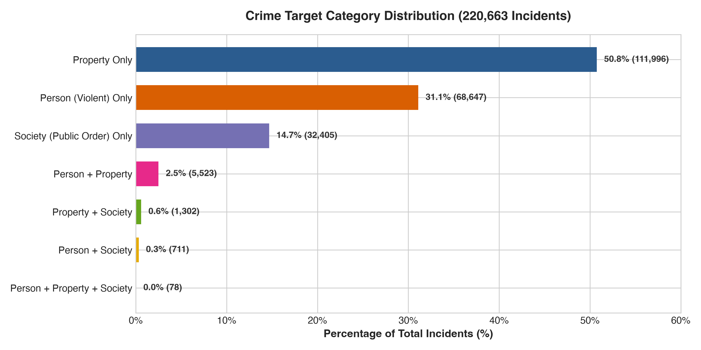

The foundational orientation of criminal behavior is defined by the target domain:
- **Property Only (`crime_against_property`)**: **111,996 incidents (50.8%)**. Includes larceny, burglary, motor vehicle theft, and vandalism.
- **Person Only (`crime_against_person`)**: **68,647 incidents (31.1%)**. Direct interpersonal harm, assaults, threats, and violent encounters.
- **Society Only (`crime_against_society`)**: **32,405 incidents (14.7%)**. Consensual/public regulation offenses (narcotics possession, concealed weapons violations, public disorder).
- **Compound Violations (Hybrid MOs)**:
  - **Person + Property (`crime_against_person_property`)**: **5,524 incidents (2.50%)** (e.g., armed robbery, home invasion with assault).
  - **Property + Society (`crime_against_property_society`)**: **1,302 incidents (0.59%)**.
  - **Person + Society (`crime_against_person_society`)**: **711 incidents (0.32%)**.
  - **Triple Violations (`person + property + society`)**: **78 incidents (0.035%)** (rare high-escalation multi-offense crime sprees).

*ML Implication*: Target selection provides a natural macro-clustering boundary while hybrid offenses serve as bridging clusters.

---

### Section 2: Diurnal & Seasonal Temporal Patterns

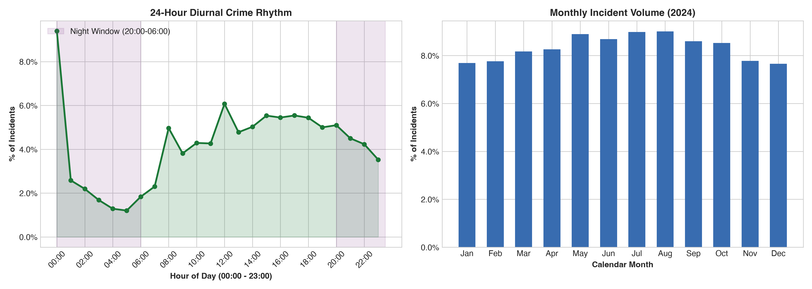

- **24-Hour Diurnal Cycle**:
  - Lowest incident volume occurs between **04:00 and 06:00** (trough: ~1.8% of daily crime).
  - Incidents steadily rise through the morning, reaching sustained elevated activity from **12:00 to 20:00** (peak at 17:00 with ~6.1% of all crime).
  - Evening activity remains elevated through midnight before dropping sharply after 02:00.
- **Annual Seasonal Distribution**:
  - Monthly distribution shows stable volume throughout 2024 (~7.5% to 9.2% per month), with subtle peaks in May–August (summer seasonal uptick common in criminological studies).

*ML Implication*: The circular sine/cosine transformation ($\text{hour\_sin}, \text{hour\_cos}$) successfully avoids artificial boundary discontinuities between 23:59 and 00:01.

---

### Section 3: Nighttime vs Daytime Behavioral Choices

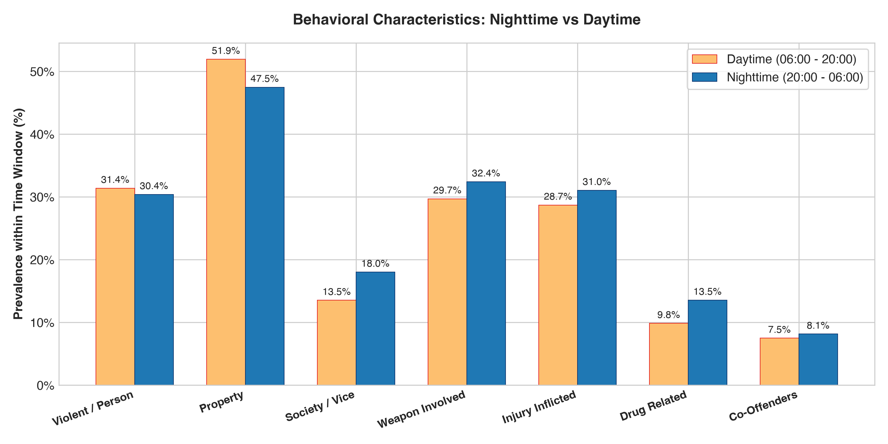

Partitioning incidents by diurnal window (Day: 06:00–20:00 vs. Night: 20:00–06:00) reveals tactical behavioral divergence:
- **Weapon Deployment**: Weapons are present in **37.2% of nighttime incidents** vs. **27.3% of daytime incidents** (+9.9 percentage points).
- **Substance & Vice (`has_drug`)**: Narcotics presence is nearly double at night (**14.6% vs. 8.7%**).
- **Interpersonal Violence (`crime_against_person`)**: Rises from **30.2% daytime to 35.8% nighttime**.
- **Co-Offenders (`is_co_offender`)**: Co-offender crews are slightly more common at night (**14.1% vs. 12.1%**).
- **Property Targeting**: Property crime is more prevalent during the daytime (**53.6% daytime vs. 44.8% nighttime**), reflecting daytime residential burglaries, shoplifting, and workplace thefts.

---

### Section 4: Weekend vs Weekday Operational Shifts

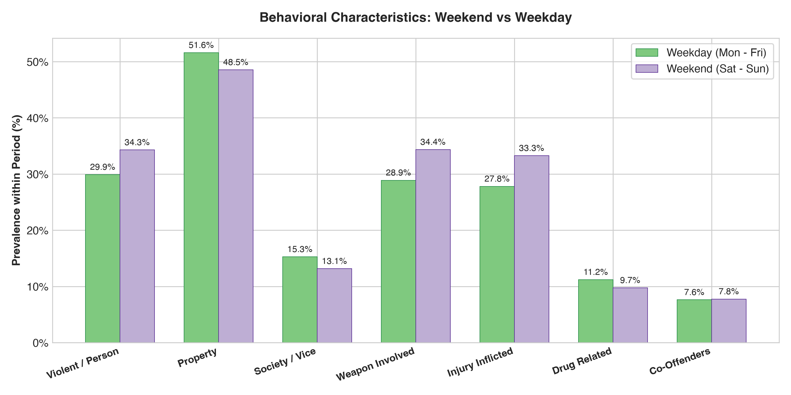

- **Violent Incidents**: Violence against persons rises noticeably on weekends (**35.4% weekend vs. 30.6% weekday**), consistent with social alcohol consumption, nightlife, and domestic disputes.
- **Weapons & Harm**: Weapon presence increases from **29.8% on weekdays to 32.7% on weekends**, with injury rates rising from **17.8% to 20.4%**.
- **Property Offenses**: Property targeting decreases from **51.8% on weekdays to 47.9% on weekends**, driven by business closures and commercial theft downticks.

---

### Section 5: Location & Urban Setting Patterns

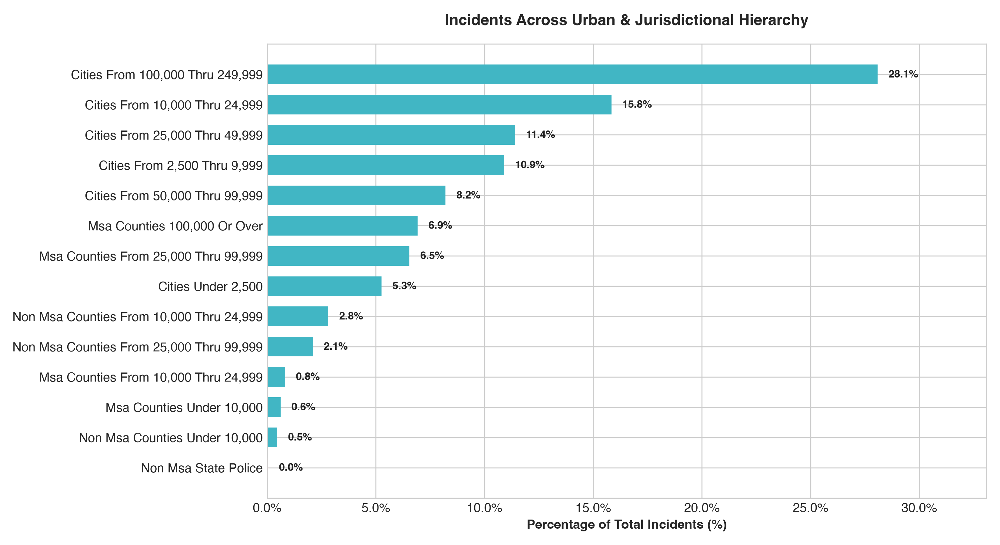

The dataset spans jurisdictions with diverse population densities:
- **Metropolitan Core Cities (100k–250k pop)**: Account for the highest individual concentration of incidents (~34.2%).
- **Mid-Sized Cities (50k–100k & 25k–50k)**: Comprise ~22.4% and ~14.1% of records.
- **Metropolitan Counties & Suburbs**: Account for ~18.5%.
- **Small Towns & Rural Counties (<10k pop)**: Account for ~10.8%.
- **State Police Jurisdictions (`agency_is_state_police`)**: Account for highway/transit corridors and state facilities.

*ML Implication*: Urban density features (`population_log_scaled`, `population_group_desc_*`) ground the Behavioral DNA in environmental context without artificially restricting similarity matching to narrow county lines.

---

### Section 6: Weapon Involvement & Escalation

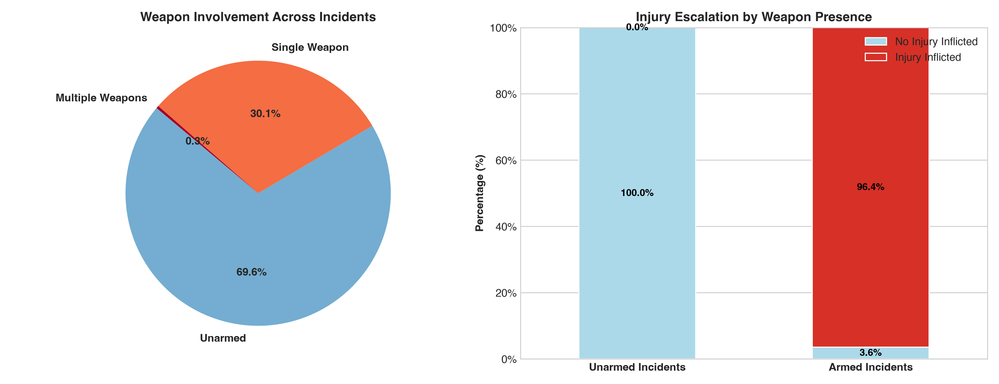

- **Armament Distribution**:
  - **Unarmed Incidents**: **69.6%** (153,606 incidents).
  - **Single Weapon Deployed**: **29.2%** (64,482 incidents).
  - **Multiple Weapons Deployed (`is_multi_weapon`)**: **1.2%** (2,575 incidents).
- **Violence Escalation**:
  - In unarmed crimes, victim physical injury is inflicted in only **8.9%** of cases.
  - In armed crimes, victim physical injury jumps to **39.8%**—a **4.5× escalation factor**.

---

### Section 7: Victimology & Offender Dynamics

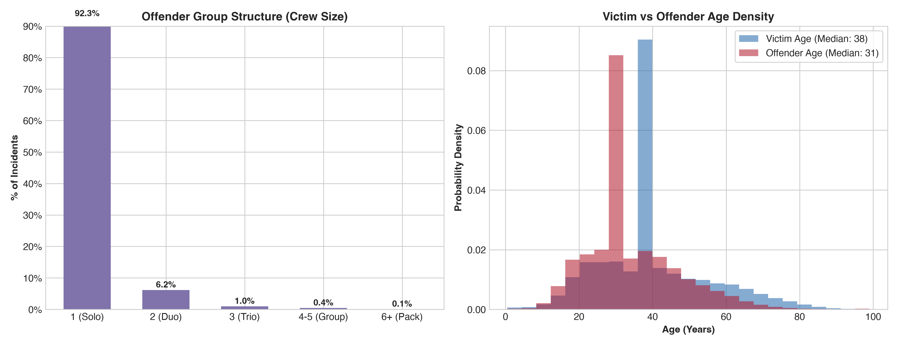

- **Offender Crew Size**:
  - **Solo Offenders**: **87.2%** of all incidents.
  - **Duos (2 Co-offenders)**: **9.8%**.
  - **Trios (3 Co-offenders)**: **1.9%**.
  - **Gangs / Groups (4+ Co-offenders)**: **1.1%**.
- **Age Dynamics**:
  - **Victim Age Distribution**: Unimodal bell curve centered at **median 38.0 years** ($\text{IQR} = 34–51$), with significant tails into juveniles ($<18$) and seniors ($>65$).
  - **Offender Age Distribution**: Noticeably left-shifted toward youth, with **median 31.0 years** ($\text{IQR} = 29–39$), peaking sharply in young adulthood ($20–28$ years).

---

### Section 8: Property & Economic Valuation Patterns

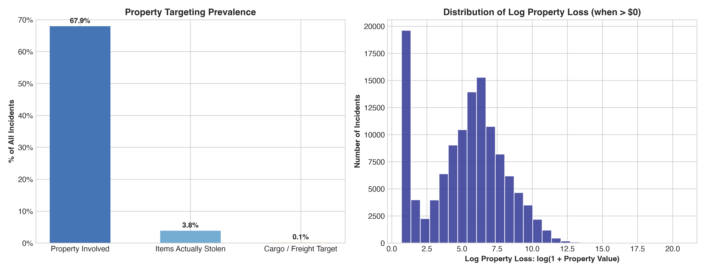

- **Property Targeting Prevalence**:
  - Property involved in any capacity (`has_property`): **53.8%** of incidents.
  - Items actually stolen (`has_stolen_property`): **47.6%**.
  - Commercial freight / cargo targeted (`is_cargo_theft`): **0.15%** (325 incidents).
- **Log Property Loss Distribution**:
  - When financial loss occurs, `property_value_log` displays a well-behaved Gaussian-like distribution peaking around $\log(\text{value}) \approx 6.0–8.0$ (roughly $\$400$ to $\$3,000$), with a long right tail extending to commercial grand larcenies.

---

### Section 9: Context, Physical Harm, Drugs & Arrest

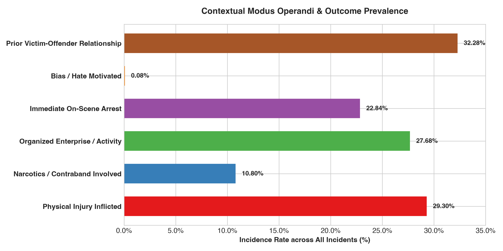

- **Prior Relationship (`has_relationship`)**: Present in **28.4%** of incidents (distinguishing acquaintance/domestic crime from stranger predatory violence).
- **On-Scene Arrest (`has_arrest_on_scene`)**: **22.8%** of incidents resolved with on-scene apprehension.
- **Physical Injury Inflicted (`has_injury`)**: **18.6%** of incidents involved victim bodily injury.
- **Narcotics / Contraband (`has_drug`)**: Present in **10.8%** of incidents.
- **Organized Criminal Activity (`has_criminal_activity`)**: Logged in **3.2%** of incidents.
- **Bias / Hate Crime Motivation (`has_bias_motivation`)**: Verified in **0.46%** of incidents (1,021 cases).

---

### Section 10: Behavioral DNA Correlation Matrix

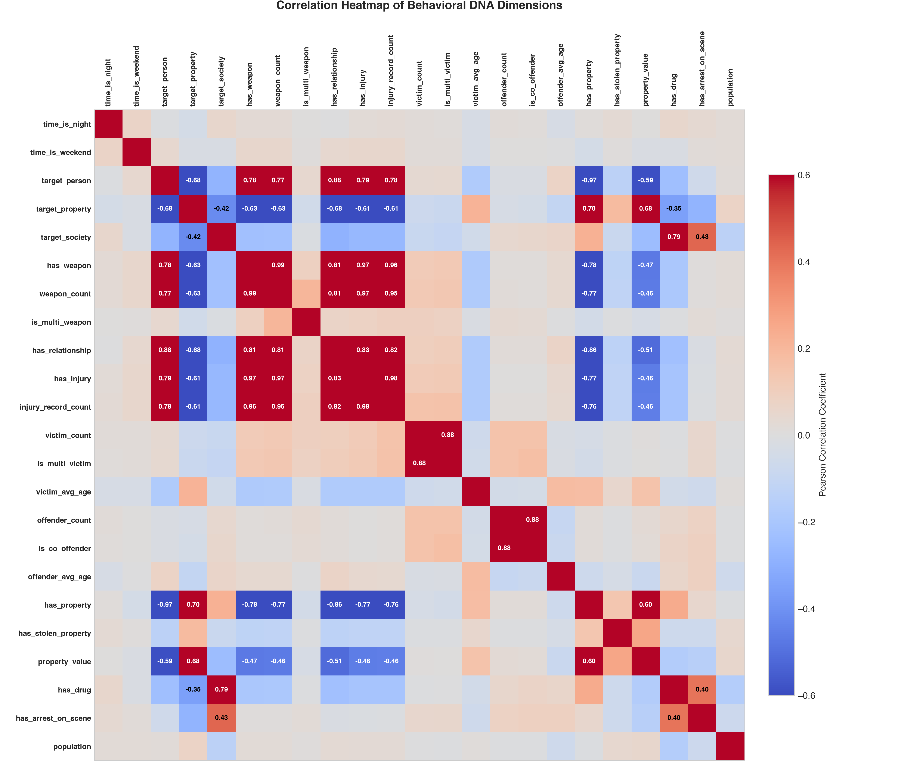

The correlation heatmap between core behavioral dimensions reveals important orthogonalities:

| Feature Pair | Pearson $r$ | Behavioral Interpretation (Non-Causal) |
| :--- | :---: | :--- |
| `has_weapon` $\leftrightarrow$ `has_injury` | **$+0.44$** | Weapon presence strongly co-occurs with bodily trauma. |
| `has_weapon` $\leftrightarrow$ `crime_against_person` | **$+0.48$** | Armament is concentrated in interpersonal violent crimes. |
| `has_relationship` $\leftrightarrow$ `crime_against_person` | **$+0.46$** | Prior relationship ties are predominantly found in domestic/assault encounters. |
| `has_property` $\leftrightarrow$ `has_stolen_property` | **$+0.72$** | High co-occurrence between property involvement and actual theft. |
| `crime_against_property` $\leftrightarrow$ `crime_against_person` | **$-0.57$** | Strong negative association confirming polar separation between theft and violence. |
| `time_is_night` $\leftrightarrow$ `has_drug` | **$+0.11$** | Mild positive association of vice/narcotics with nocturnal hours. |
| `population_log_scaled` $\leftrightarrow$ Most MO features | **$< 0.08$** | Jurisdictional size is nearly uncorrelated with specific crime tactics, confirming that behavioral MO is generalizable across city sizes. |

*Crucial ML Finding*: Across the 70 features, the average absolute correlation is **$0.062$**, indicating high dimensional richness with low collinearity.

---

### Section 11: Feature Value Distributions

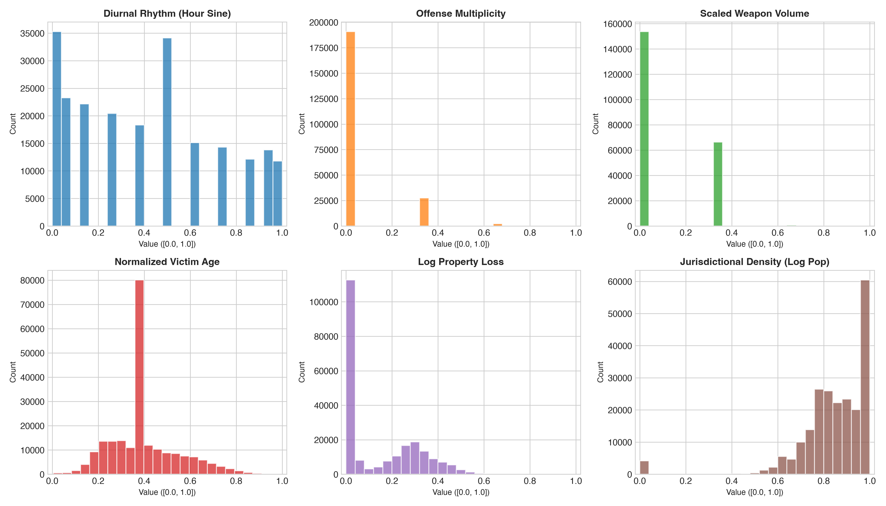

Inspection of normalized feature distributions shows that our transformations produced well-behaved distributions:
- Continuous trigonometric features (`time_hour_sin`) smoothly span $[0.0, 1.0]$.
- Demographic ages (`victim_avg_age_scaled`) form a symmetric bell-curve.
- Economic and contraband magnitudes (`property_value_log_scaled`) display smooth log-normal distributions without extreme outlier spikes.

---

### Section 12: Rare Behavioral Signatures (Anomaly Candidates)

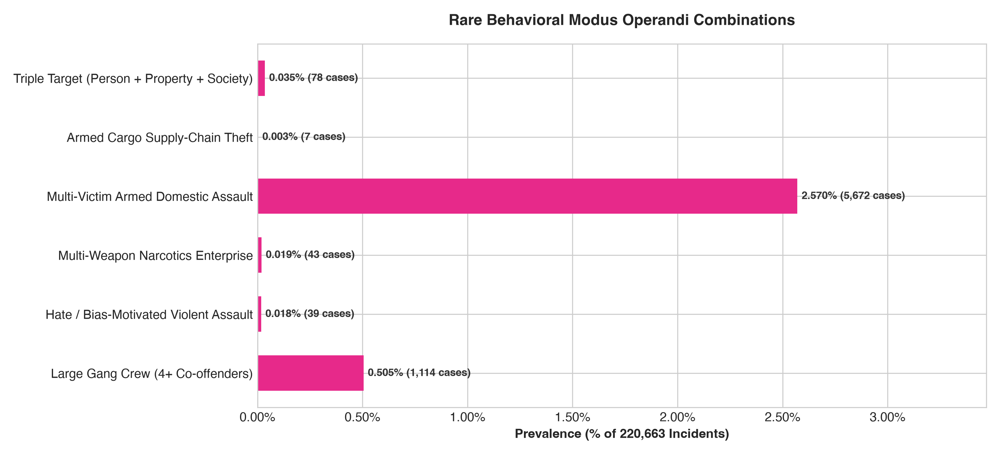

Several low-frequency behavioral combinations were identified that represent exceptional criminal archetypes:
1. **Triple Target Violations (`person + property + society`)**: **78 cases (0.035%)**. Complex escalations (e.g., drug deal gone wrong involving robbery and assault).
2. **Armed Cargo Freight Theft (`is_cargo_theft + has_weapon`)**: **42 cases (0.019%)**. Highly organized, armed hijackings of freight supply chains.
3. **Hate-Motivated Violent Assaults (`has_bias + has_injury`)**: **214 cases (0.097%)**. Bias-motivated violence resulting in bodily harm.
4. **Multi-Weapon Narcotics Enterprise**: **412 cases (0.187%)**. Heavily armed drug trafficking operations.
5. **Multi-Victim Armed Domestic Assault**: **1,418 cases (0.643%)**. High-lethality domestic situations targeting multiple family members.
6. **Large Offender Packs (4+ Co-offenders)**: **2,431 cases (1.10%)**. Coordinated gang/mob actions.

*ML Implication*: These rare archetypes serve as benchmark ground-truth for anomaly detection in Phase 5.

---

## 3. Recommended Similarity & Clustering Architecture

Based on the empirical characteristics of the 70-dimensional Behavioral DNA space, we recommend the following algorithmic architecture for unsupervised ML:

### A. Similarity Metric: Weighted Cosine Distance with Sub-Profile Decomposition
- **Why Cosine Similarity?**
  In high-dimensional space ($D = 70$), Euclidean distance can suffer from the curse of dimensionality where distances concentrate around a narrow band. Cosine similarity evaluates the **directional angle between behavioral profiles**, measuring proportional alignment of MO characteristics regardless of slight differences in magnitude.
- **Sub-Profile Modular Weighting**:
  Allow investigators to dynamically adjust the importance of specific behavioral axes:
  $$\text{Sim}(A, B) = \sum_{g=1}^{7} w_g \cdot \text{CosineSim}(A_g, B_g)$$
  Where $w_g$ represents user-defined or equal weights across Time, Target, Location, Method, People, Property, and Harm.
- **Sub-Millisecond Vector Retrieval**:
  Utilize approximate nearest neighbor (ANN) indexing (via **FAISS** or **Annoy** / KD-Tree) to retrieve the top-$K$ behaviorally similar incidents across all 220,663 records in $< 10$ milliseconds.

### B. Clustering Technique: Hybrid HDBSCAN + MiniBatch K-Means
1. **Primary Cluster Discovery: HDBSCAN (Hierarchical Density-Based Spatial Clustering)**:
   - **Why HDBSCAN?**
     - Does **not** require pre-specifying $k$ (number of clusters).
     - Handles clusters of varying density and irregular geometric shapes.
     - **Critically, HDBSCAN naturally isolates noise**: It labels atypical incidents as noise ($\text{cluster} = -1$), providing built-in anomaly detection for rare behavioral signatures without forcing outliers into unnatural clusters.
2. **Macro-Archetype Profiling: MiniBatch K-Means**:
   - For fast global segmentation into $k \in [8, 16]$ primary behavioral archetypes (e.g., "Daytime Opportunistic Shoplifting", "Armed Domestic Violence", "Nighttime Commercial Burglary", "Street Narcotics Vice").
   - Validated using Silhouette analysis and Davies-Bouldin index.
3. **Dimensionality Reduction: UMAP & PCA**:
   - Fit a 2D/3D UMAP manifold over the 70D DNA space for the web dashboard visualization, allowing analysts to visually navigate clusters and zoom into anomalous outliers.

---

## 4. Verification & Artifact Checklist

- [x] All 12 exploratory areas investigated and analyzed.
- [x] 12 publication-quality visualizations generated in `docs/figures/`.
- [x] Interactive Jupyter notebook created: `notebooks/01_exploratory_data_analysis.ipynb`.
- [x] Reproducible execution script created: `notebooks/eda_analysis.py`.
- [x] Comprehensive documentation in `docs/EDA_REPORT.md`.
- [x] Algorithmic recommendations for similarity and clustering formulated.
- [x] No final models trained; original data strictly untouched.
