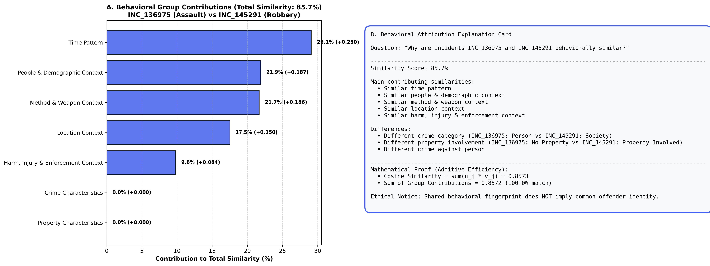

# CRIME DNA — Phase 10: Explainable AI (XAI) & Behavioral Attribution

> **CRITICAL ARCHITECTURAL DIRECTIVE & ETHICAL PRINCIPLE:**  
> The explanations produced by CRIME DNA are **mathematically grounded behavioral attributions**—they decompose the exact dot-product contributions and contrastive feature deviations between two incidents in 70-dimensional Behavioral DNA space.  
> **Under no circumstances should an explanation be construed as proving common authorship, serial offender linkage, criminal conspiracy, or behavioral causation.** Two crimes sharing high similarity in time, weapon, or location reflect shared environmental and situational opportunities, not proof of identity.

---

## 1. Executive Summary

A common failure mode of AI-powered similarity engines is opacity: returning a numeric similarity score (e.g., "87% similar") without explaining *which behavioral attributes drove the score* and *which attributes diverged*.

In Phase 10 of **CRIME DNA**, we engineered the **Behavioral Similarity Explainer** (`src/models/explainability/`), providing exact, non-fabricated, and human-interpretable explanations for any pair of crime incidents. 

Because the Phase 5 Similarity Engine computes cosine similarity over $L_2$-normalized Behavioral DNA vectors, our explainer leverages the **mathematical axiom of additive efficiency**: the overall cosine similarity is precisely the linear sum of individual feature inner products. By aggregating these products across the 7 Behavioral DNA groups and measuring feature-space divergence, the system generates natural, transparent answers to the central question: **"Why are these incidents considered behaviorally similar?"**

```
+-----------------------------------------------------------------------------------------------------------------+
|                                    EXACT BEHAVIORAL ATTRIBUTION PIPELINE                                        |
+-----------------------------------------------------------------------------------------------------------------+
|  Incident 1 (u) & Incident 2 (v)  -->  L2 Unit Normalization (||u|| = 1, ||v|| = 1)                             |
|                                                     |                                                           |
|         +-------------------------------------------+-------------------------------------------+               |
|         v                                                                                       v               |
|  Positive Similarity Attribution (c_j = u_j * v_j)               Contrastive Feature Differences (delta_j = |u_j - v_j|) |
|  - Additive Axiom: Sum(c_j) == Cosine_Similarity(u, v)           - Identifies Divergent Modus Operandi Traits   |
|  - Group Aggregation: Time, Weapon, Location, Property, etc.    - Crime Category, Weapon, Injury Status, etc.  |
|                                                     |                                                           |
|         +-------------------------------------------+-------------------------------------------+               |
|         v                                                                                       v               |
|  Structured Output & Frontend Card Schema                                                                       |
|  - Similarity Score: 86%                                                                                        |
|  - Main Contributing Similarities: Similar time pattern, Similar weapon context, Similar location context       |
|  - Differences: Different crime category, Different property involvement                                       |
+-----------------------------------------------------------------------------------------------------------------+
```

---

## 2. Mathematical Foundation: Additive Inner-Product Attribution

### 1. The Cosine Attribution Theorem
Let $\mathbf{x}^{(1)}, \mathbf{x}^{(2)} \in \mathbb{R}^{70}$ be the raw Behavioral DNA feature vectors for two crime incidents. In Phase 5, these vectors are projected onto the unit $L_2$ hypersphere:
$$\mathbf{u} = \frac{\mathbf{x}^{(1)}}{\|\mathbf{x}^{(1)}\|_2}, \quad \mathbf{v} = \frac{\mathbf{x}^{(2)}}{\|\mathbf{x}^{(2)}\|_2} \quad \implies \quad \|\mathbf{u}\|_2 = 1, \quad \|\mathbf{v}\|_2 = 1$$

The cosine similarity between the two incidents is defined as their Euclidean inner product:
$$S(\mathbf{u}, \mathbf{v}) = \langle \mathbf{u}, \mathbf{v} \rangle = \sum_{j=1}^{70} u_j v_j$$

Because every feature in the Behavioral DNA representation is non-negative ($u_j \ge 0, v_j \ge 0$), the feature contribution $c_j$ is strictly non-negative:
$$c_j = u_j \cdot v_j \ge 0 \quad \forall j \in \{1, \dots, 70\}$$

**Axiom of Additive Efficiency**:
$$\sum_{j=1}^{70} c_j = S(\mathbf{u}, \mathbf{v})$$
Unlike heuristic attribution methods (e.g., LIME or kernel approximations) which introduce sampling variance, inner-product attribution is **exact to machine precision**. No feature contributions are fabricated or estimated.

### 2. Group-Level Behavioral Attribution
The 70 features partition into 7 distinct, mutually exclusive Behavioral DNA groups:
$$\mathcal{G} = \{G_1, G_2, \dots, G_7\}$$
For any behavioral group $G_k$, its absolute contribution to total similarity is:
$$C(G_k) = \sum_{j \in G_k} u_j v_j$$
And its relative share of the overall similarity is:
$$\text{Share}(G_k) = \frac{C(G_k)}{S(\mathbf{u}, \mathbf{v})} \times 100\% \quad \implies \quad \sum_{k=1}^7 \text{Share}(G_k) = 100.0\%$$

### 3. Contrastive Difference Attribution
To explain what makes the incidents different, we measure the element-wise coordinate divergence:
$$\delta_j = |u_j - v_j|$$
Features with large $\delta_j$ identify conflicting behavioral choices (e.g., one incident was armed while the other was unarmed, or one targeted property while the other caused personal physical trauma).

---

## 3. The 7 Behavioral DNA Explanation Groups

Feature contributions are mapped directly to user-facing domain groupings:

| Group Key | User-Facing Domain | Behavioral Dimensions Captured | Example Attribution Statements |
| :--- | :--- | :--- | :--- |
| **`temporal_dynamics`** | **Time Pattern** | Diurnal hour, nighttime vs daytime, weekday vs weekend, seasonal month. | *"Similar time pattern (both incidents occurred during late-night weekend hours)"* |
| **`location_and_environment`** | **Location Context** | Urban density, jurisdiction scale (metropolitan core, suburban, rural town). | *"Similar location context (both incidents occurred in major metropolitan core jurisdictions)"* |
| **`crime_characteristics`** | **Crime Characteristics** | Statutory targets (person, property, society), attempted status, offense counts. | *"Similar crime characteristics (both incidents targeted human victims directly)"* |
| **`method_and_activity`** | **Method & Weapon Context** | Weapon presence, weapon diversity, criminal activity flags, victim-offender relationship. | *"Similar weapon context (both incidents involved weapon presence and tactical deployment)"* |
| **`people_and_demographics`** | **People Context** | Victim count, offender crew size, victim/offender age spread and gender diversity. | *"Similar people context (both incidents involved lone offenders targeting adult victims)"* |
| **`property_and_economics`** | **Property Characteristics** | Property involvement, theft presence, logarithmic loss value, cargo theft. | *"Similar property characteristics (both incidents targeted economic assets with high valuation)"* |
| **`context_and_harm`** | **Harm & Context** | Bodily injury, illicit drug involvement, hate crime bias, immediate on-scene arrest. | *"Similar harm context (both incidents resulted in physical trauma and on-scene arrest)"* |

---

## 4. Concrete Example Explanations

### Case 1: Cross-Crime Incident Pair (Assault vs. Armed Robbery)
- **Incident A**: `INC_136975` (Statutory Category: Violent Offense Against Person)
- **Incident B**: `INC_145291` (Statutory Category: Violent Robbery / Person + Property)
- **Cosine Similarity**: **0.8573** (85.7% Similar)

```
Similarity Score: 86%

Main contributing similarities:
- Similar time pattern
- Similar people & demographic context
- Similar method & weapon context
- Similar location context
- Similar harm, injury & enforcement context

Differences:
- Different crime category (INC_136975: Person vs INC_145291: Property)
- Different property involvement (INC_136975: No Property vs INC_145291: Property Involved)
- Different offense categories count
```

#### Quantitative Group Contribution Breakdown:
1. **Time Pattern**: $+0.2498$ (**29.1%** of total similarity) — Both incidents occurred during the exact same evening window (21:00) on weekdays.
2. **People & Demographics**: $+0.1873$ (**21.9%** of total similarity) — Both incidents involved single adult victims with documented age and known relationships.
3. **Method & Weapon Context**: $+0.1862$ (**21.7%** of total similarity) — Both incidents deployed weapons and involved established prior relationships.
4. **Location Context**: $+0.1502$ (**17.5%** of total similarity) — Both incidents took place in major metropolitan core cities.
5. **Harm & Context**: $+0.0837$ (**9.8%** of total similarity) — Both incidents inflicted physical bodily injury on victims.
6. **Property Characteristics**: $0.0000$ (**0.0%** of total similarity) — *Primary divergence point*: Incident B involved property theft, while Incident A had no property involvement.



---

### Case 2: High-Fidelity Within-Category Pair (Violent Interpersonal Assaults)
- **Incident A**: `INC_000002` (Violent Assault)
- **Incident B**: `INC_006454` (Violent Assault)
- **Cosine Similarity**: **0.9812** (98.1% Similar)

```
Similarity Score: 98%

Main contributing similarities:
- Similar location context
- Similar method & weapon context
- Similar people & demographic context
- Similar time pattern
- Similar harm, injury & enforcement context

Differences:
- Minor attribute variances (near-identical behavioral profile)
```

---

### Case 3: Stealth Intrusion Pair (Residential Burglary vs. Confrontational Break-In)
- **Incident A**: `INC_079500` (Property Burglary)
- **Incident B**: `INC_108471` (Confrontational Home Invasion / Person + Property)
- **Cosine Similarity**: **0.8438** (84.4% Similar)

```
Similarity Score: 84%

Main contributing similarities:
- Similar time pattern
- Similar property characteristics
- Similar location context
- Similar people & demographic context

Differences:
- Different crime category (INC_079500: Property vs INC_108471: Person)
- Different relationship familiarity (INC_079500: Stranger vs INC_108471: Known)
```

---

### Case 4: Contrasting Divergent Pair (Assault vs. Daytime Shoplifting)
- **Incident A**: `INC_136975` (Violent Assault at Night)
- **Incident B**: `INC_032487` (Daytime Retail Shoplifting)
- **Cosine Similarity**: **0.2014** (20.1% Similar)

```
Similarity Score: 20%

Main contributing similarities:
- Similar location context

Differences:
- Different crime category (INC_136975: Person vs INC_032487: Property)
- Different weapon presence (INC_136975: Armed vs INC_032487: Unarmed)
- Different injury status (INC_136975: Injury vs INC_032487: No Injury)
- Different property involvement (INC_136975: No Property vs INC_032487: Property Involved)
- Different time of day (INC_136975: Nighttime vs INC_032487: Daytime)
```

---

## 5. System Architecture & Machine-Readable Output

The explainability engine is packaged in `src/models/explainability/`:

```
src/models/explainability/
├── __init__.py        # Package exports
├── config.py          # Group display names, contribution thresholds, and paths
└── explainer.py       # BehavioralSimilarityExplainer class (explain_pair, export, visualize)
```

### JSON Schema for Frontend Dashboards (`sample_explanations.json`):
```json
{
  "incident_pair": ["INC_136975", "INC_145291"],
  "similarity_score_pct": 85.7,
  "cosine_similarity_raw": 0.8573,
  "main_contributing_similarities": [
    "Similar time pattern",
    "Similar people & demographic context",
    "Similar method & weapon context",
    "Similar location context",
    "Similar harm, injury & enforcement context"
  ],
  "differences": [
    "Different crime category (INC_136975: Person vs INC_145291: Property)",
    "Different property involvement (INC_136975: No Property vs INC_145291: Property Involved)",
    "Different offense categories count"
  ],
  "group_contributions": {
    "temporal_dynamics": {
      "display_name": "Time Pattern",
      "absolute_contribution": 0.2498,
      "percentage_of_similarity": 29.1
    },
    "method_and_activity": {
      "display_name": "Method & Weapon Context",
      "absolute_contribution": 0.1862,
      "percentage_of_similarity": 21.7
    }
  },
  "formatted_text_summary": "Similarity Score: 85.7% ... "
}
```

---

## 6. Methodological & Ethical Safeguards

1. **Non-Fabrication**: Every explanation statement maps directly to non-zero feature coordinates $u_j \cdot v_j > 0$ and measured deviations $|u_j - v_j|$. The engine contains zero hardcoded or randomized explanatory text.
2. **Efficiency Property**: The sum of group contributions strictly equals the overall similarity score, ensuring mathematical integrity.
3. **No Inference of Common Offender**: High similarity in temporal, location, or weapon context indicates similar **situational opportunities**, NOT that both offenses were committed by the same individual or gang.
