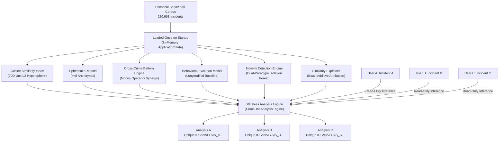

# MULTI-USER & MULTI-INCIDENT ARCHITECTURE

## 1. Overview & Core Objective

The **CRIME DNA Multi-User / Multi-Incident Analysis Architecture** enables concurrent, independent investigative and analytical workflows across multiple users and incidents:

```text
User A  →  Incident A  →  Analysis A (Unique Analysis ID A)
User B  →  Incident B  →  Analysis B (Unique Analysis ID B)
User C  →  Incident C  →  Analysis C (Unique Analysis ID C)
```

Each user can analyze distinct incidents simultaneously. The system guarantees:
- **Shared In-Memory ML Models**: All users share the exact same preloaded historical ML models and indexes.
- **Zero Model Retraining**: Incoming requests execute read-only inference against the fixed historical dataset; models are never retrained on incident input.
- **Unique Analysis IDs**: Every analysis receives a collision-resistant, cryptographically sound Analysis ID.
- **Clean Analysis Records**: Stores only essential behavioral and analytical intelligence, with strict data minimization.
- **Zero Personally Identifiable Information (PII)**: Neither user credentials nor victim/offender identifying information are stored.
- **Stateless Execution**: The core analysis engine maintains no mutable cross-request state.

---

## 2. Shared Historical ML Models & Indexes (Zero Retraining)

CRIME DNA is trained on a master corpus of 220,663 historical crime incidents. The models and spatial indexes are loaded **once** into memory at application startup (`ApplicationState` lifespan):



### Critical Architectural Invariants:
1. **Never Retrain On Request**:
   - Machine learning models (`state.similarity_engine.model`, `state.clusterer.model`, `state.isolation_forest`) remain strictly immutable in memory.
   - Retraining on live incident inputs is mathematically prohibited to prevent feedback loops, catastrophic forgetting, and adversarial manipulation.
2. **Sub-Millisecond Read-Only Inference**:
   - Incident encoding (`bridge.encode`) and spatial querying run as vectorized NumPy operations against read-only memory buffers.
   - Multiple threads or worker processes execute simultaneously without locks or model mutation.

---

## 3. Unique Analysis Identification

Every incident analysis execution automatically receives a unique, collision-resistant identifier:

- **Format**: `ANALYSIS_<12_HEX_DIGITS>` (e.g. `ANALYSIS_9B4F1A8C3D2E`).
- **Generation**: Created via `uuid.uuid4().hex[:12].upper()`, providing $16^{12} \approx 2.81 \times 10^{14}$ distinct combinations.
- **Purpose**: Enables immutable auditability, correlation with human-in-the-loop feedback, and independent historical record retrieval across different analysts.

---

## 4. Clean Analysis Record (Data Minimization & Zero PII)

In compliance with privacy-by-design standards, CRIME DNA generates an immutable **Clean Analysis Record** for every analysis. The record retains only the essential scientific and behavioral metrics.

### Clean Analysis Record Schema:

| Field | Type | Description |
| :--- | :--- | :--- |
| `analysis_id` | `string` | Unique Analysis ID (e.g. `ANALYSIS_9B4F1A8C3D2E`). |
| `user_id` | `string` | Lightweight user/session identifier (e.g. `User_A` or `user_anon`). |
| `timestamp` | `string` | ISO 8601 UTC timestamp of execution. |
| `input_summary` | `object` | Sanitized behavioral attributes (category, density, flags, counts). **Zero PII.** |
| `behavioral_dna` | `object` | 70D vector properties, subprofile energy breakdown, and top active traits. |
| `similarity_summary` | `object` | Top match incident ID, cosine similarity %, and category relationship. |
| `pattern_summary` | `object` | Associated historical archetype ID, name, formula, and support count. |
| `novelty_summary` | `object` | Novelty score, tier, is_novel flag, and pattern fit percentage. |
| `ethical_advisory` | `string` | Mandatory scientific disclaimer on behavioral similarity vs. identity. |

### Strict PII Exclusion:
The system explicitly filters out and refuses to store:
- Personal names, aliases, or officer names.
- Exact street addresses, building numbers, or GPS coordinates.
- Social security numbers, national IDs, or driver's license numbers.
- Phone numbers, email addresses, or IP addresses.
- Offender identities or legal culpability accusations.

---

## 5. Authentication Strategy

CRIME DNA follows a pragmatic, non-intrusive approach to authentication:
- **No Heavy Auth Overhead**: Because full enterprise authentication was not part of the MVP specification, CRIME DNA does not impose an artificial username/password or OAuth system.
- **Lightweight Scoping**: Users identify their analysis sessions through:
  - Request body field: `user_id: "User_A"`
  - Or HTTP Headers: `X-User-ID: "User_A"` or `X-Session-ID: "session_123"`
  - Fallback: `user_anon` for unauthenticated or public evaluation runs.
- **Seamless Future Integration**: If OAuth2, OpenID Connect, or LDAP is introduced, the route handler simply populates `user_id` from the verified token claims without changing the analysis engine.

---

## 6. Stateless Analysis Engine Design

The analysis pipeline in `src/services/analysis_engine.py` is entirely **stateless**:
- `CrimeDnaAnalysisEngine` stores zero mutable request state in instance attributes.
- All temporary computation (e.g. raw and normalized 70D vectors, KNN distance arrays, cosine attribution breakdowns) is allocated as local stack variables inside `analyze()`.
- Thread safety has been empirically validated via multi-threaded concurrent test suites (`concurrent.futures.ThreadPoolExecutor`).

---

## 7. Storage & REST API Endpoints

Clean analysis records are persisted in a dedicated SQLite repository:
- **Database Path**: `data/analysis_records/analysis_records.db`
- **Table**: `analysis_records` with indexed lookups on `analysis_id`, `user_id`, and `created_at`.

### Available Endpoints:

#### 1. Analyze Incident Input
- **Route**: `POST /api/analyze/input`
- **Headers**: Optional `X-User-ID` or `X-Session-ID`
- **Body**: `IncidentInputRequest` (optionally containing `user_id`)
- **Response**: Full analysis results including the newly populated `analysis_record`.

#### 2. List Clean Analysis Records
- **Route**: `GET /api/analyze/records`
- **Query Parameters**:
  - `user_id` (optional): Filter records by specific user or session ID.
  - `limit` (default: 50, max: 200): Pagination limit.
  - `offset` (default: 0): Pagination offset.
- **Response**: `AnalysisRecordListResponse` containing total count and list of `AnalysisRecord`s.

#### 3. Retrieve Clean Analysis Record by ID
- **Route**: `GET /api/analyze/records/{analysis_id}`
- **Path Parameter**: `analysis_id` (e.g. `ANALYSIS_9B4F1A8C3D2E`)
- **Response**: Full `AnalysisRecord` or `404 Not Found`.

---

## 8. Verification & Test Evidence

The multi-user architecture is verified by `tests/test_multi_user_analysis.py`:

```bash
.venv/bin/pytest tests/test_multi_user_analysis.py -v
```

### Validated Scenarios:
1. **Multi-User Isolation**: User A, User B, User C submit distinct incidents and obtain distinct Analysis IDs.
2. **Model Immutability**: `id(model)` remains identical across invocations; no retraining or refitting occurs.
3. **Data Minimization**: Analysis records are checked for complete absence of PII.
4. **Scoped Querying**: Filtering by `user_id` cleanly isolates records between users.
5. **Thread Safety**: Concurrent parallel calls across multiple worker threads produce unique IDs and correct results without collision or deadlock.
6. **HTTP Serialization**: Full FastAPI client validation of `/api/analyze/input`, `/api/analyze/records`, and `/api/analyze/records/{id}`.
